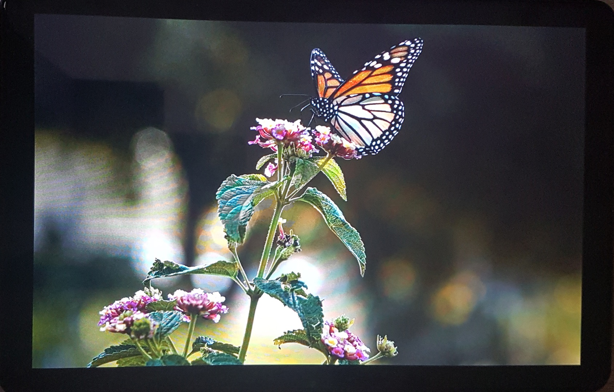 
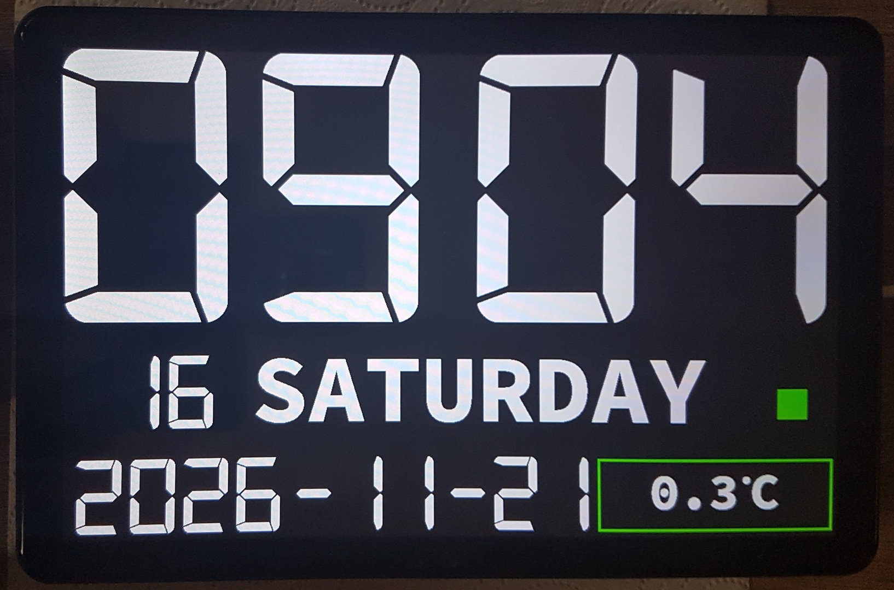 
# Project JC8012P4A1C (ECO7 / Rev. 3.2) - ESP32-P4 Clock Panel (MIPI-DSI & ESP32-C6)

---

## 🇺🇸 English Version

A low-level, highly optimized framework for a vector clock, TrueType font rendering, and both automatic and manual NTP time synchronization designed for the ESP32-P4 (Silicon Revision v3.2 / ECO7 @ 400 MHz) paired with an 800x1280 MIPI-DSI display (Portrait, 80 MHz DSI clock / 60 Hz refresh rate). Networking and coprocessor tasks are offloaded to the ESP32-C6 via a high-speed hardware SDIO bus.

### 🛠️ Important Instructions Before First Compilation

If you cloned this repository and want to successfully compile and run the project on your hardware, you must perform two essential configuration steps:

#### 1. Generating the SPIFFS Partition Image (Photos/Resources)
The project stores slideshow graphics on a dedicated Flash partition. To force the build system to automatically generate and flash the SPIFFS image during the project compilation:
* Open the `main/CMakeLists.txt` file.
* Locate and **uncomment** (remove the `#` character) the following line:
  ```cmake
  spiffs_create_partition_image(storage "\${CMAKE_CURRENT_LIST_DIR}/../FOTOS" FLASH_IN_PROJECT)
  ```
* Ensure that you have a folder named `FOTOS` containing the required image files (`FOTO1.jpg`, `FOTO2.jpg`) in the root directory of the project (next to the `main` folder) before starting the build.

#### 2. Initial Wi-Fi Configuration (Saving Credentials to SPIFFS)
The system securely retrieves network credentials directly from the non-volatile storage (SPIFFS) flash memory. Upon flashing the device for the first time, you must store your network credentials into the Flash structure:
* Open the `main/RTC.cpp` file.
* Navigate to the `init_RTC_subsystem(void)` function.
* **Uncomment** the following line for a single run, filling in your actual network credentials (SSID and Password):
  ```cpp
  save_wifi_credentials_to_SPIFFS("YOUR_SSID", "YOUR_PASSWORD");
  ```

OR
* Locate and **uncomment** (remove the `#` character) the following line:
  ```cmake
  spiffs_create_partition_image(storage "\${CMAKE_CURRENT_LIST_DIR}/../FOTOS" FLASH_IN_PROJECT)

Create a plain text file named "prefs.ini" inside the FOTOS folder containing two lines: your Wi-Fi SSID on the first line and your password on the second line.
* Compile and flash the device. Once the device boots up for the first time and successfully commits the data to SPIFFS, **comment this line out again** in main/CmakeLists.txt file [#spiffs_create_partition_image(storage "\${CMAKE_CURRENT_LIST_DIR}/../FOTOS" FLASH_IN_PROJECT)] to avoid redundant Flash cell overwrites on subsequent flashing.
#### ⚙️ Build Optimization Recommendations

* **Compiler Optimization (`-O2`):** This project is configured and built with full performance optimization (**`-O2`**, `CONFIG_COMPILER_OPTIMIZATION_PERF=y` in `sdkconfig.defaults`). Any earlier flickering or visual artifacts under `-O2` have been completely eliminated thanks to full hardware-synchronized **double buffering** (`flush_screen_vsync`).
* **ESP-IDF Version (`v6.1.1`):** This firmware was developed, compiled, and verified exclusively using **ESP-IDF v6.1.1**. Due to rapid changes in MIPI-DSI, PSRAM, and `esp_hosted` drivers across framework releases, there is no guarantee that compiling with any other ESP-IDF version will succeed without modifications.
 

---
## Key Features

* **High-Speed MIPI-DSI Display & Hardware VSYNC:** Smooth, tear-free rendering driven by the ESP32-P4 MIPI-DSI interface with VSYNC semaphore synchronization and DMA cache management (`esp_cache_msync`).
* **Real-Time 3D Vector Dots Engine:** Interactive 3D wireframe/point-cloud sphere animation (`vectordotsball`) rendered smoothly on the MIPI-DSI framebuffer.
* **Dynamic TrueType Font Rendering:** Crisp, anti-aliased vector typography (`stb_truetype`) rendered dynamically at arbitrary font sizes across the clock face and settings screens.
* **Built-in SoftAP & HTTP Wi-Fi Setup Portal:** Zero-hardcode Wi-Fi configuration via an embedded HTTP server (`http://192.168.4.1`). Tap **WiFi** in the touch menu, connect to **`ESP32-CLOCK-SETUP`** from any phone or PC, and save credentials directly to SPIFFS (`/spiffs/prefs.ini`).
* **Automatic NTP Time Synchronization:** Non-blocking background time sync via the onboard ESP32-C6 co-processor (`esp_wifi_remote` / `esp_hosted` over SDIO) with automatic CET/CEST daylight saving time support.
* **Software JPEG Decoding & PWM Backlight Control:** Built-in support for `esp_new_jpeg` graphics decoding, GSL3680 capacitive touch input, and smooth PWM backlight dimming/wake-up.
* **SPIFFS Resource Management (`FOTOS`):** Dedicated SPIFFS storage for slideshow images (`FOTO1.jpg`, `FOTO2.jpg`), Wi-Fi credentials (`prefs.ini`), and weather location coordinates (`weather.ini`). Detailed setup instructions are available in the [FOTOS/Readme.MD](FOTOS/Readme.MD) file.
* **Test PAINT Application:** Added a built-in test **PAINT** drawing application to showcase touch responsiveness and smooth rendering on the display.
* **Multi-Location Weather & Timezone Selector:** Independent on-screen switching between Bydgoszcz, London, and Pakistan (Islamabad) for both Open-Meteo weather coordinates and POSIX timezones, with smart NVS wear-leveling protection.

---
## 🇵🇱 Wersja Polska

Zoptymalizowany system operacyjny zegara wektorowego, renderowania grafiki TrueType oraz synchronizacji NTP dla ESP32-P4 (v3.2/ECO7 @ 400 MHz) z ekranem MIPI-DSI 800x1280 (60 Hz). Łącznością i koprocesorem zarządza układ ESP32-C6 przez magistralę SDIO.

### 🛠️ Ważne instrukcje przed pierwszą kompilacją

Jeśli pobrałeś ten projekt i chcesz go pomyślnie skompilować oraz uruchomić na swoim urządzeniu, musisz wykonać dwa kluczowe kroki konfiguracyjne:

#### 1. Generowanie obrazu partycji SPIFFS (Zdjęcia/Zasoby)
Projekt przechowuje grafiki pokazu slajdów na dedykowanej partycji Flash. Aby system automatycznie zbudował i wgrał obraz pamięci SPIFFS podczas kompilacji projektu:
* Otwórz plik `main/CMakeLists.txt`.
* Znajdź i **odkomentuj** (usuń znak `#`) poniższą linię:
  ```cmake
  spiffs_create_partition_image(storage "\${CMAKE_CURRENT_LIST_DIR}/../FOTOS" FLASH_IN_PROJECT)
  ```
* Upewnij się, że w głównym katalogu projektu (obok folderu `main`) posiadasz folder `FOTOS` zawierający pliki graficzne (`FOTO1.jpg`, `FOTO2.jpg`) przed uruchomieniem budowania.

#### 2. Pierwsza konfiguracja sieci Wi-Fi (Zapis w pamięci SPIFFS)
Projekt korzysta z bezpiecznego odczytu danych logowania do sieci bezpośrednio z nieulotnej pamięci flash (SPIFFS). Przy pierwszym uruchomieniu urządzenia na nowej płytce należy fizycznie zapisać te dane w strukturze Flash:
* Otwórz plik `main/RTC.cpp`.
* Przejdź do funkcji `init_RTC_subsystem(void)`.
* **Odkomentuj** na jedno uruchomienie poniższą linię, wpisując swoje rzeczywiste dane sieciowe (SSID oraz Hasło):
  ```cpp
  save_wifi_credentials_to_SPIFFS("TWOJE_SSID", "TWOJE_HASLO");
  ```
* Skompiluj i sflaszuj urządzenie. Po pierwszym uruchomieniu i pomyślnym zapisie danych w pamięci SPIFFS, **ponownie zakomentuj tę linię**, aby nie nadpisywać niepotrzebnie komórek Flash przy każdym kolejnym restarcie urządzenia.

ALBO

dodaj plik tekstowy w folderze FOTOS o nazwie "prefs.ini", a w jego 2 liniach wpisz Twoje SSID i w drugiej linii Twoje HASŁO

* Otwórz plik `main/CMakeLists.txt`.
* Znajdź i **odkomentuj** (usuń znak `#`) poniższą linię:
  ```cmake
  spiffs_create_partition_image(storage "\${CMAKE_CURRENT_LIST_DIR}/../FOTOS" FLASH_IN_PROJECT)
  ```

po kompilacji i sflaszowaniu zakomentuj tą linię krzyżykiem: #spiffs_create_partition_image(storage "\${CMAKE_CURRENT_LIST_DIR}/../FOTOS" FLASH_IN_PROJECT) aby za każdym razem zbędnie nie flaszować partycji SPIFFS

#### ⚙️ Zalecenia dotyczące optymalizacji kompilacji
* **Optymalizacja kompilatora (`-O2`):** Projekt jest skonfigurowany i budowany z pełną optymalizacją wydajności (**`-O2`**, `CONFIG_COMPILER_OPTIMIZATION_PERF=y` w `sdkconfig.defaults`). Wcześniejszy flickering oraz artefakty obrazu występujące przy `-O2` zostały całkowicie wyeliminowane dzięki pełnemu **podwójnemu buforowaniu (double buffering)** zsynchronizowanemu z VSYNC.
* **Wersja ESP-IDF (`v6.1.1`):** Ten program został napisany, skompilowany i przetestowany wyłącznie w wersji **ESP-IDF v6.1.1**. Ze względu na częste zmiany w sterownikach MIPI-DSI, PSRAM oraz `esp_hosted` między wydaniami frameworka, nie ma żadnej gwarancji, że użycie jakiejkolwiek innej wersji ESP-IDF pozwoli na poprawne zbudowanie projektu.

## Główne funkcje (Key Features)

* **Szybki wyświetlacz MIPI-DSI i sprzętowy VSYNC:** Płynne renderowanie obrazu bez efektu rozrywania klatek (tearingu) przez interfejs MIPI-DSI układu ESP32-P4 z synchronizacją semaforem VSYNC i zarządzaniem pamięcią podręczną DMA (`esp_cache_msync`).
* **Silnik 3D Vector Dots w czasie rzeczywistym:** Płynna animacja obracającej się sfery 3D złożonej z punktów wektorowych (`vectordotsball`) renderowana bezpośrednio w buforze ramki MIPI-DSI.
* **Dynamiczne renderowanie czcionek TrueType:** Ostra, wygładzana typografia wektorowa (`stb_truetype`) generowana w locie w dowolnym rozmiarze na tarczy zegara oraz w ekranach ustawień.
* **Wbudowany portal konfiguracyjny SoftAP i serwer HTTP:** Konfiguracja Wi-Fi bez wpisywania haseł w kodzie źródłowym, przez wbudowany serwer WWW (`http://192.168.4.1`). Wystarczy dotknąć **WiFi** w menu, połączyć się z siecią **`ESP32-CLOCK-SETUP`** z telefonu lub komputera i zapisać dane w pamięci SPIFFS (`/spiffs/prefs.ini`).
* **Automatyczna synchronizacja czasu NTP:** Pobieranie aktualnego czasu w tle przez koprocesor ESP32-C6 (`esp_wifi_remote` / `esp_hosted` po SDIO) z automatyczną obsługą zmiany czasu letniego i zimowego (CET/CEST).
* **Programowe dekodowanie JPEG i sterowanie podświetleniem PWM:** Obsługa dekodera `esp_new_jpeg`, pojemnościowego panelu dotykowego GSL3680 oraz wygaszania i wybudzania podświetlenia ekranu przez PWM.
* **Zarządzanie zasobami SPIFFS (`FOTOS`):** Dedykowana partycja SPIFFS przechowująca zdjęcia pokazu slajdów (`FOTO1.jpg`, `FOTO2.jpg`), dane sieci Wi-Fi (`prefs.ini`) oraz współrzędne lokalizacji dla pogody (`weather.ini`). Szczegółowa instrukcja konfiguracji znajduje się w pliku [FOTOS/Readme.MD](FOTOS/Readme.MD).
* **Testowa aplikacja PAINT:** Dodano wbudowaną testową aplikację do rysowania **PAINT**, demonstrującą responsywność ekranu dotykowego oraz płynność renderowania obrazu.
* **Wybór lokalizacji pogody i stref czasowych:** Niezależne przełączanie w menu dotykowym między Bydgoszczą, Londynem i Pakistanem (Islamabad) dla prognozy pogody Open-Meteo oraz stref czasowych POSIX, z inteligentnym zapisem do NVS chroniącym pamięć Flash.

---
 
 
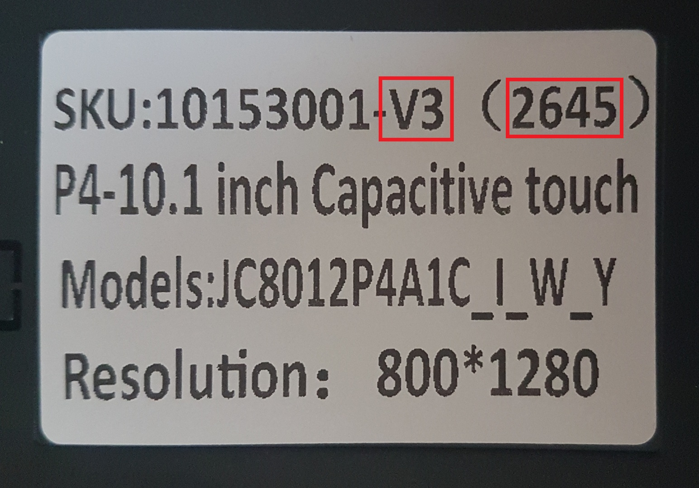 
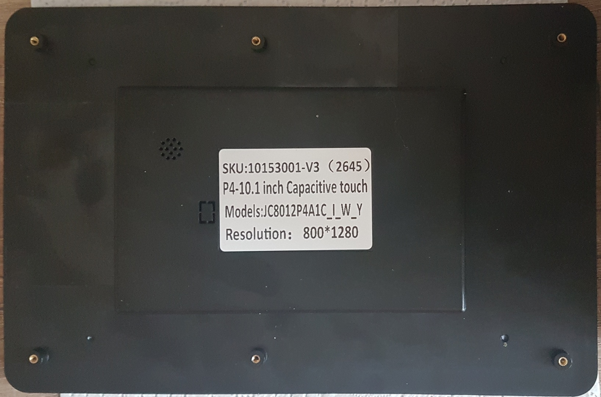 
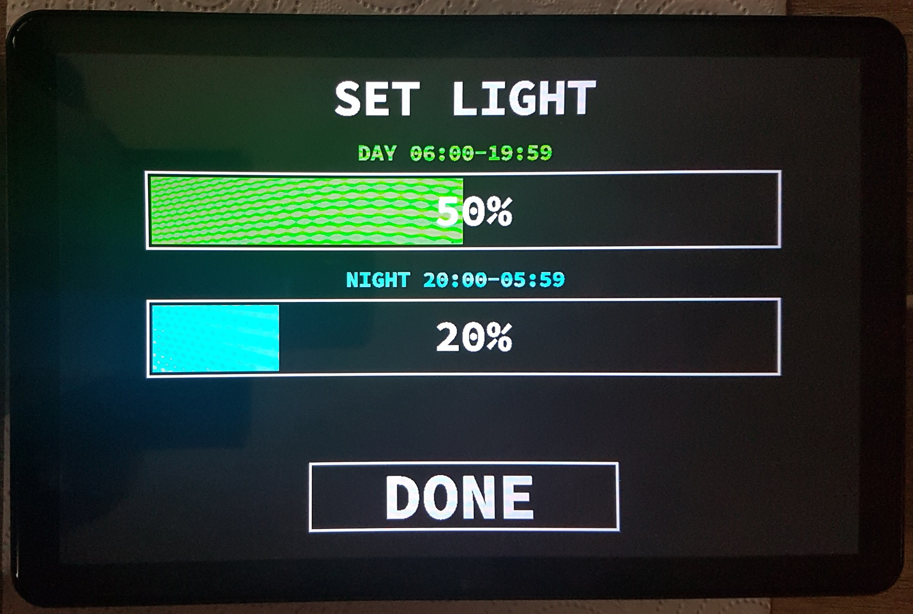 
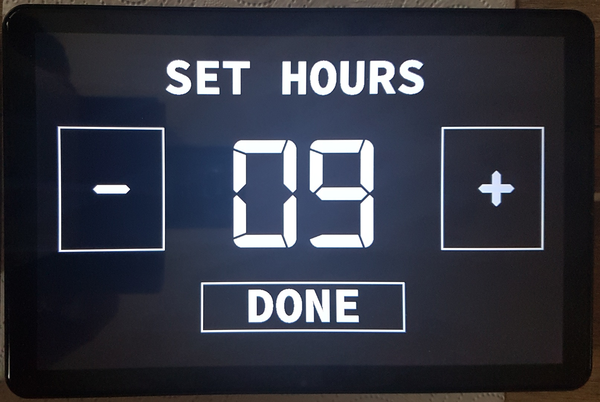 
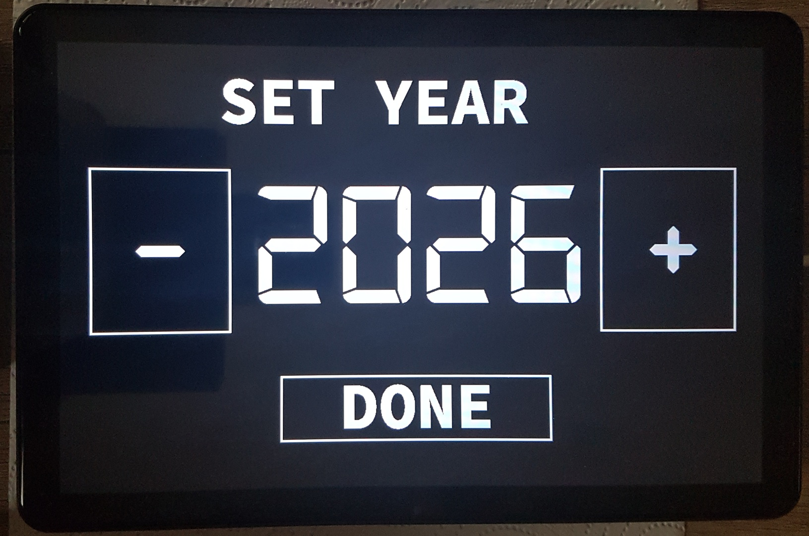 
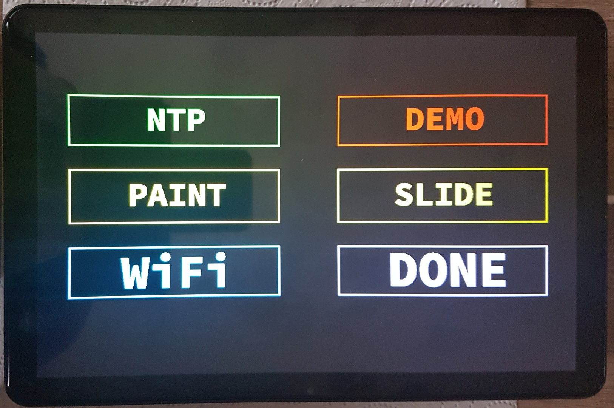 
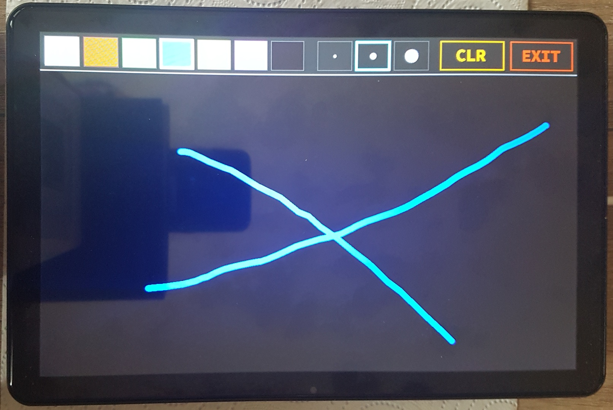 
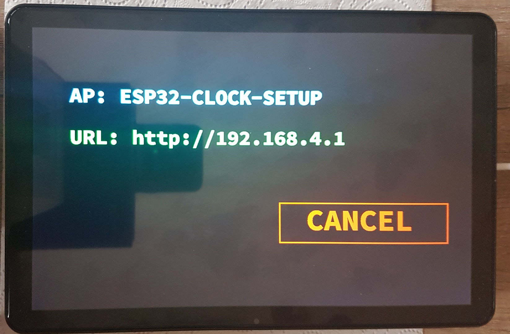 
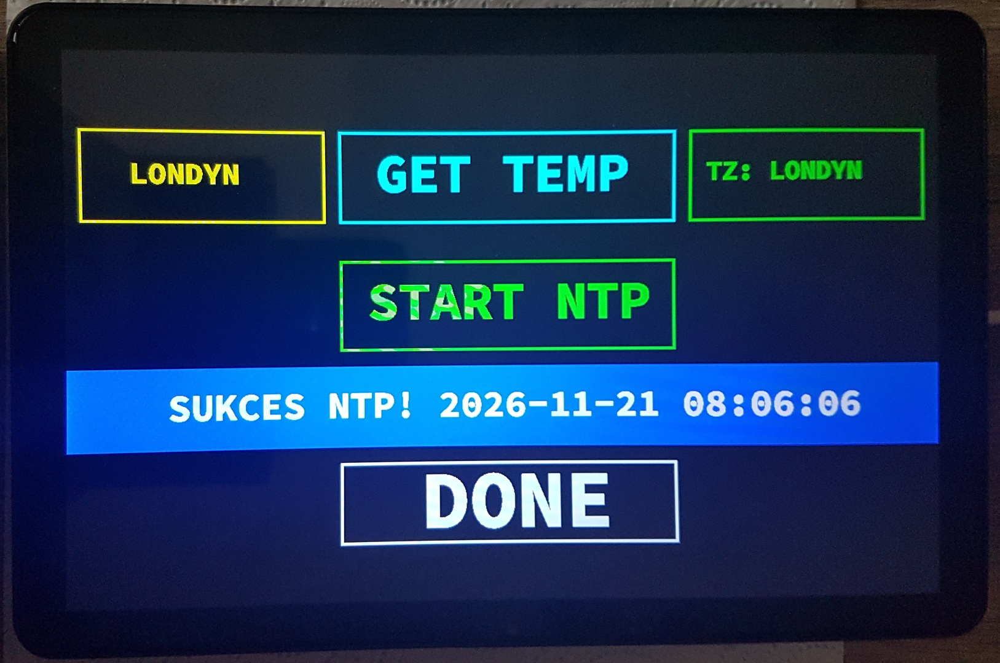 
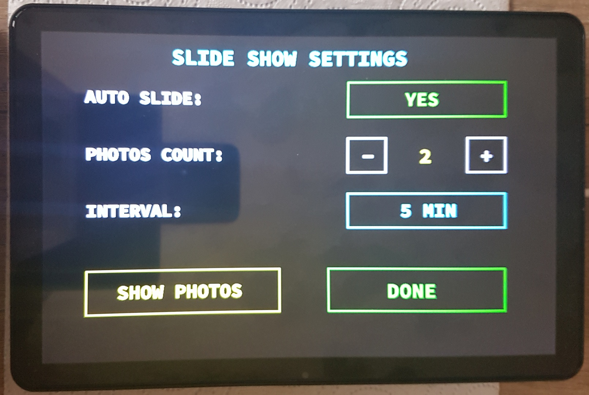 
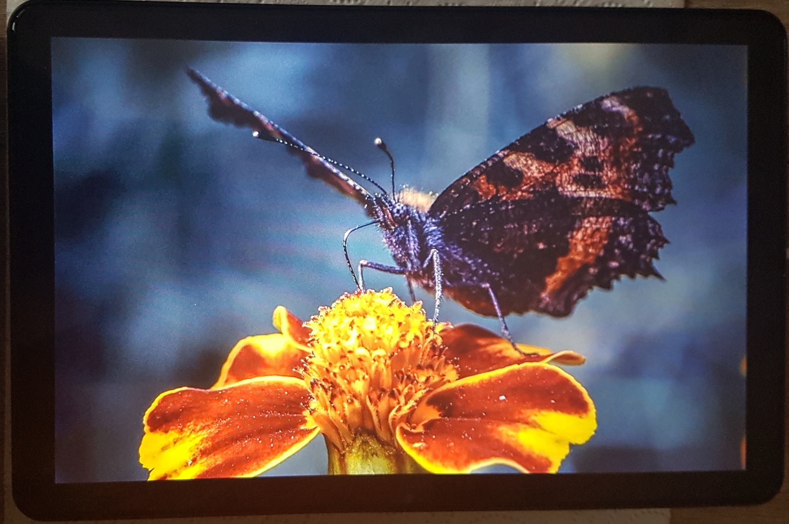 
 
# ---
